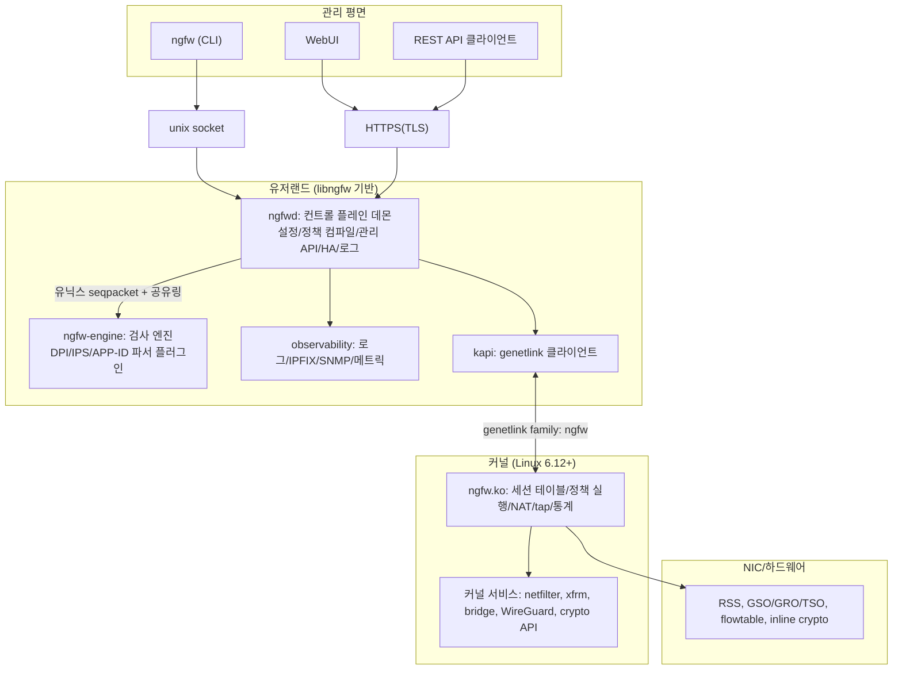
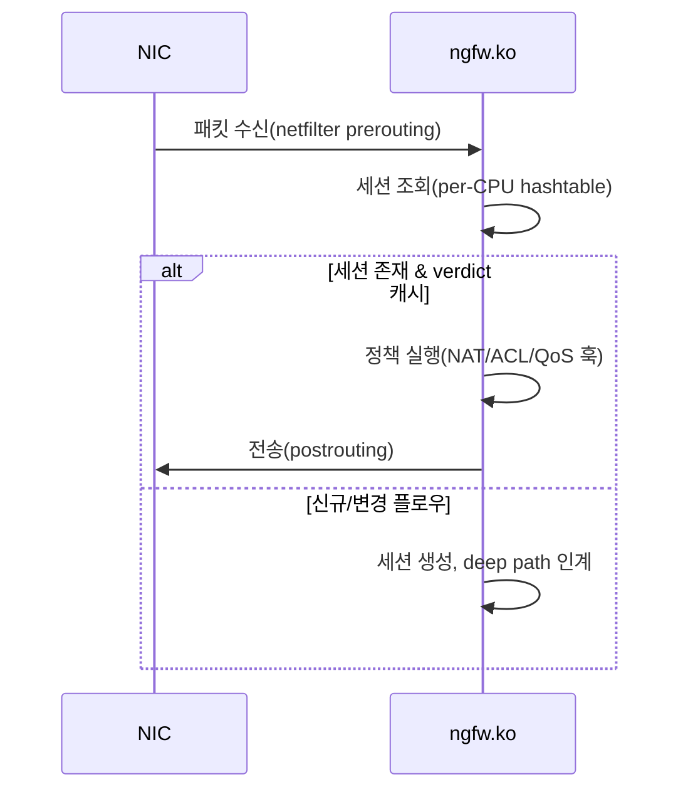
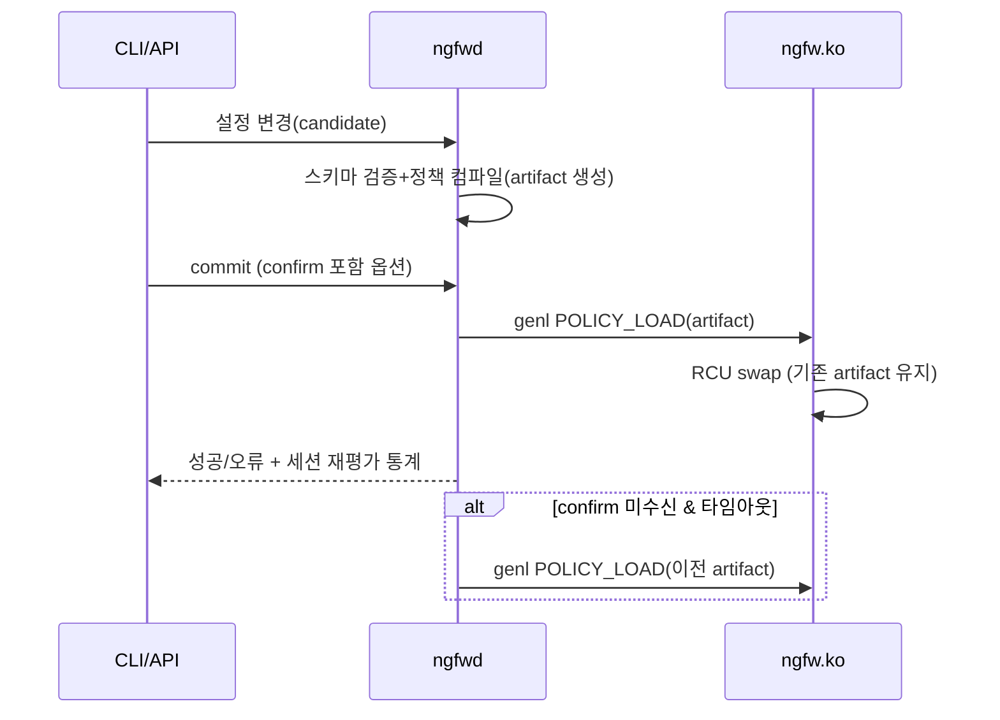

# 02. 전체 아키텍처

## 1. 시스템 개요도



## 2. 계층 구조(L0~L4)

계층은 **의존 방향**을 정의한다: 상위→하위 단방향, 역방향 통신은 콜백/이벤트로만(R08).

| 계층 | 이름 | 책임 | 구성 |
|---|---|---|---|
| L4 | management | 사용자 접점(CLI/WebUI/REST), UX 규칙 | `ngfw`, webui |
| L3 | services | 데몬 구성, 라이프사이클, 프로세스 간 협력 | `ngfwd`, `ngfw-engine` |
| L2 | domain | 도메인 로직: 정책, DPI, VPN, 서비스 프로토콜, ID, HA, 관측 | libngfw 서브시스템 |
| L1 | core | 공통 기반: 메모리/이벤트루프/링/로그/설정트리/IPC/직렬화 | libngfw `core` |
| L0 | platform | libc/OS 추상화(호환성 유일 지점) | libngfw `platform` |
| K | kernel | 커널 모듈+커널 서비스 | `kernel/ngfw.ko` |

경계 규칙:

- L0만 `#include <sys/...>`, `<unistd.h>` 등 OS 헤더를 직접 포함할 수 있다(예외: 비휘발성 표준
  POSIX 헤더 `<stdint.h>`, `<string.h>` 등은 전 계층 허용).
- L2 서브시스템 간 직접 호출 금지. 필요 시 L1의 이벤트/인터페이스 계약 경유.
- 커널 모듈(K)은 커널 API만 사용하며 libngfw에 의존하지 않는다. 코드 공유는 안 함(계약 문서만 공유).

## 3. 컴포넌트 맵

| 컴포넌트 | 계층 | 형태 | 책임 | 상세 |
|---|---|---|---|---|
| `ngfw.ko` | K | 커널 모듈 | 세션 테이블, 정책 실행, NAT, tap 인계, 통계, 오프로드 연계 | `03` |
| `ngfwd` | L3 | 데몬(루트→권한강하) | 설정 저장/컴파일, genetlink 제어, 관리 API 서버, HA, 로그 파이프라인 | `11` |
| `ngfw-engine` | L3 | 데몬(비특권) | deep path 검사: 재조립/파서/시그니처/verdict | `06` |
| `ngfw` | L4 | CLI 도구 | 사용자 명령, `selftest`, `top`, `doctor` 프론트 | `11` |
| libngfw | L0~L2 | 정적 라이브러리 | 위 서브시스템들의 본체 | §5 |
| webui | L4 | 정적 자원 | SPA 자원(HTML/JS/CSS), ngfwd가 서빙 | `11` §6 |

## 4. 프로세스·스레드 모델

### 4.1 프로세스

| 프로세스 | 권한 | 생성/감독 | 장애 격리 |
|---|---|---|---|
| `ngfw-init` | root | PID 1 (어플라이언스) | 서비스 순서 기동, 코어덤프 수거 |
| `ngfwd` | root → 권한강하(helper 유지) | init/시스템 매니저 | 감독 루프, 코어 수거 후 재시작 |
| `ngfw-engine` | 비특권 사용자 | ngfwd 자식(fork+exec) | 크래시 시 세션 fail-open/close 정책 적용 후 재시작 |

- `ngfwd`와 `ngfw-engine`의 분리 이유: 검사 코드(복잡도 높음)의 크래시 격리, 권한 분리(R-P-D).
- 커널 세션은 유지되므로 엔진 재시작 중에도 fast path 트래픽은 계속 처리된다(fail-open/close
  옵션은 신규 deep path 플로우에 적용, `04` §5).

### 4.2 스레드(ngfwd)

| 스레드 | 수 | 역할 |
|---|---|---|
| main(이벤트루프) | 1 | 모든 제어 이벤트(설정/API/genl 이벤트/타이머) 단일 스레드 처리 |
| log-writer | 1 | 로그/이벤트 버스 소비→싱크 출력 |
| ha-conn | 0~1 | HA 동기화 연결 처리 |
| mgmt-worker | 0~N | REST/WebUI 대형 요청(선택적, 기본 main에서 처리) |

### 4.3 스레드(ngfw-engine)

| 스레드 | 수 | 역할 |
|---|---|---|
| tap-in | N(=CPU 코어, RSS 큐 정렬) | NFQUEUE 패킷 수신/파싱/재조립/분류/verdict |
| timer | 1 | 세션 타임아웃 협조, 시그니처 리로드 |

엔진 내부는 스레드당 자료구조 소유(single-writer), 공유 자료(시그니처 DB, 앱 테이블)는 읽기전용
RCU 포인터 교체로 갱신한다(`06` §4).

## 5. 주요 데이터 흐름

### 5.1 fast path (커널 내 완결)



### 5.2 deep path (유저랜드 검사)

1. 커널이 신규 플로우의 첫 패킷(또는 정책상 검사 대상)을 NFQUEUE tap으로 인계(기본 정책: **분류
   전 잠정 허용 아님** — 정책의 `pending-action`(기본 deny) 따름, `05` §5).
2. `ngfw-engine`이 재조립/분류/검사 수행 → verdict(allow/deny)+app-id+profile 결정.
3. verdict를 genetlink로 커널 세션에 기록 → 이후 패킷은 fast path.
4. 분류 업그레이드(중간에 APP-ID 변경/위협 탐지) 시 세션 재평가 이벤트 발생.

### 5.3 컨트롤 플로우(설정 적용)



## 6. 모듈 간 인터페이스 경계

경계별 통신 수단과 계약 문서(유일 출처):

| 경계 | 수단 | 계약 문서 |
|---|---|---|
| `ngfw.ko` ↔ `ngfwd`/`kapi` | genetlink family `ngfw` v1 (제어) + multicast 이벤트 | `03` §7 |
| 커널 tap ↔ `ngfw-engine` | NFQUEUE(mmap mode) + verdict 채널 | `04` §4 |
| `ngfwd` ↔ `ngfw-engine` | unix seqpacket(제어) + shared memory ring(이벤트/통계) | `06` §6 |
| `ngfw` ↔ `ngfwd` | unix socket(로컬 CLI), TCP+TLS(원격 REST) | `11` §3 |
| 설정 파일 ↔ 데몬 | JSON + 스키마(파일 시스템) | `11` §4 |
| 플러그인 ↔ libngfw | 버전화 C ABI 테이블 | `19` |

## 7. 소스 디렉터리 레이아웃(설계상 목표 구조)

파편화 방지(R07): 유저랜드 공용 코드는 `libngfw` 단일 정적 라이브러리로 통합(ADR-003), 서브시스템은
디렉터리+헤더 계약으로만 분리한다.

```
ngfw/
├── VERSION                 # 단일 출처: 버전/제품명/모델 계보(20)
├── configure.ac            # Autotools 진입(16)
├── Makefile.am             # GNU Make 래퍼
├── designs/                # 본 설계 문서
├── docs/                   # 표준/조사/참조 문서
├── include/ngfw/           # 공개 헤더(모듈 간 계약, 유일 노출 지점)
├── src/lib/                # libngfw 본체
│   ├── platform/           # L0: libc/OS 추상화
│   ├── core/               # L1: mem/evloop/ring/log/config/IPC
│   ├── crypto/             # L2: 자체 암호 라이브러리(ADR-005)
│   ├── netproto/           # L2: 패킷 파서/프로토콜 인코더
│   ├── policy/             # L2: 정책 모델/컴파일러
│   ├── dpi/                # L2: 재조립/파서/시그니처
│   ├── identity/           # L2: 인증/사용자-그룹
│   ├── vpn/                # L2: IKEv2/SSL-VPN 컨트롤
│   ├── services/           # L2: DHCP/DNS/NTP/라우팅
│   ├── observ/             # L2: 로그/IPFIX/SNMP/메트릭
│   ├── mgmt/               # L2: CLI 엔진/REST 서버
│   ├── ha/                 # L2: HA
│   └── kapi/               # L2: genetlink 클라이언트
├── src/daemon/             # L3: 컨트롤 데몬 (ngfwd)
├── src/engine/             # L3: 검사 엔진 (ngfw-engine)
├── src/cli/                # L4: CLI (ngfw)
├── src/tools/              # selftest/doctor/tgen/image 빌더
├── kernel/                 # ngfw.ko (Kbuild, 커널 스타일)
├── webui/                  # WebUI 자원
├── tests/                  # 유닛 테스트
└── scripts/                # 빌드/설치/QEMU/Docker 스크립트
```

include 규칙: `src/lib` 내부 코드는 `include/ngfw/` 공개 헤더와 자기 서브시스템 헤더만 포함 가능
(레이어 검사 스크립트로 강제, `17` §3).

프로그램 소스 디렉터리 이름은 산출물 이름과 동일하게 두지 않는다(예: `ngfw` 바이너리의 소스는
`src/cli/ngfw.c`). automake 링크 규칙이 빌드 디렉터리에서 프로그램 파일을 `rm -f` 로 제거하므로
동명 디렉터리와 충돌한다(M0 구현에서 확인된 빌드 계약).

## 8. 부팅 시퀀스(어플라이언스)

1. 부트로더 → 커널 → `ngfw-init`(PID 1).
2. `ngfw-init`: 파일시스템 마운트(설정 파티션 검증), 환경 자가진단(F15, `12` §8), 순서 기동:
   네트워크 → `ngfwd` → `ngfw-engine`.
3. `ngfwd`: 설정 로드(손상 시 공장 기본값+경보) → 커널 모듈 로드/바인딩 → 정책 아티팩트 적재 →
   관리 인터페이스 개방 → HA 조인.
4. `ngfw-engine`: 시그니처 DB 로드 → tap 구독 → 준비 완료 보고.
5. 부트 완료 이벤트 + `ngfw-doctor` 진단 스냅샷 기록.

## 9. 장애 격리 및 디그레이드 정책

| 장애 | 기본 동작 | 옵션 |
|---|---|---|
| `ngfw-engine` 크래시 | 기존 세션 fast path 유지, 신규 deep path는 세션별 pending-action(fail-close 기본) | fail-open |
| `ngfwd` 크래시 | 커널은 마지막 artifact로 계속 동작, 관리 중단 | init 재시작 감독 |
| 커널 모듈 언로드/크래시 | 시스템 패닉 방지를 위해 모듈은 오류 시 자체 해제 후 기본 커널 포워딩 복원 | 보수적 |
| 설정 파티션 손상 | 공장 기본 설정으로 기동 + 경보 | - |
| HA peer 장애 | VRRP 선출 전환(`13`) | - |

## Change log

- 2026-10-23: M0 구현 결과 반영 — 산출물 이름과 소스 디렉터리 이름 충돌 방지 규칙 도입(src/daemon, src/engine, src/cli).
- 2026-10-23: 초판 작성.
