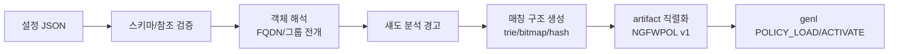

# 05. 정책 엔진 (Policy Engine)

## 1. 책임/범위

정책 모델 정의, 검증, 컴파일(아티팩트 생성), NAT 의미론, 세션 재평가 규칙. 소속: libngfw
`policy` 서브시스템 + `ngfwd` 컴파일 파이프라인. 커널 실행부는 `03-kernel-dataplane.md` §6.

## 2. 객체 모델

| 객체 | 필드 | 참조 표기 |
|---|---|---|
| zone | 인터페이스 목록, 종류(라우티드/브리지/호스트) | `zone:*` |
| address | CIDR/range/FQDN(해석 결과 캐시)/그룹 | `addr:` |
| service | 프로토+포트/포트레인지/ICMP 타입/그룹 | `svc:` |
| application | APP-ID 계층(카테고리/앱/서브타입, `06` §6) | `app:` |
| user | 사용자/그룹(`10-user-identity.md`) | `user:` |
| schedule | 반복 시간대(로컬 TZ 명시) | `sched:` |
| profile | inspect/ips/url/tls/qos/har 프로파일 참조 묶음 | `prof:` |
| rule | 아래 §3 | - |

모든 객체는 JSON 설정(`11` §4)에서 정의되고 정책 컴파일러가 해석한다. FQDN 객체의 DNS 해석은
`ngfwd`가 주기적 갱신(캐시 TTL), 컴파일 시점에 IP 집합으로 확정한다.

## 3. 규칙(rule) 스키마

```json
{
  "name": "allow-office-web",
  "match": {
    "src-zone": ["trust"],          "dst-zone": ["untrust"],
    "src-addr": ["group:office"],   "dst-addr": ["any"],
    "service":  ["svc:https", "svc:dns-udp"],
    "application": ["any"],        "user": ["any"],
    "schedule": ["business-hours"]
  },
  "action": "allow",                // allow|deny|drop|reject
  "inspect": {                      // deep path 요구
    "mode": "always",               // always|first|none
    "profile": "prof:std-web",
    "pending-action": "deny"        // 분류 전 잠정 동작
  },
  "nat":    null,                   // 또는 {"type":"src","pool":"pool:out1"}
  "qos":    {"class-id": 3},
  "log":    {"start": true, "close": true},
  "session-sync": true,             // HA 동기화 대상
  "timeout-profile": null,
  "disable": false
}
```

규칙 집합은 **순서 기반 top-down first-match**, 마지막에 암묵적 `deny all`(R06: 기본 보수적).
존 쌍(intra/inter)은 매칭 필드이며 전역 디폴트 규칙보다 우선한다.

## 4. 컴파일 파이프라인



- 검증 오류는 규칙 이름/필드 경로와 함께 보고(R06). 섀도(도달 불가) 규칙은 경고로 보고하되
  컴파일은 성공.
- 컴파일은 `ngfwd` 워커에서 실행(수백 ms 목표), 실패 시 기존 artifact 유지.

## 5. 매칭 알고리즘

1단계 후보 축소 → 2단계 정밀 판정:

```
candidates = src_ip_trie.lookup(sip)  ∩  dst_ip_trie.lookup(dip)     /* 규칙 id 집합 */
candidates ∩= service_bitmap[proto].lookup(dport, sport)
if app_classified: candidates ∩= app_table[app_id].rule_set
if user_bound:     candidates ∩= user_group_table[user_id].rule_set
if schedule:       현재 시각으로 스케줄 필터 재평가
verdict = candidates 중 최소 rule index (top-down) 실행
```

- 자료구조: IP는 LPM trie(v4/v6 통합, zone-별 서브트리), 포트는 비트맵(65536/8=8KiB·프로토),
  app/user는 역인덱스(rule_set 비트맵).
- 복잡도: 후보 축소 O(log n)+비트맵 AND. 후보 수(전형 <32)에 대해 선형 최소 인덱스 선택.
- 스케줄/시간은 컴파일 시간 값이 아니라 실행 평가(시간에 따른 verdict 변화 → 기존 세션 재평가
  이벤트는 스케줄 경계 시각에 발화).

## 6. NAT 의미론

| 유형 | 동작 | 비고 |
|---|---|---|
| src NAT(SNAT) | postrouting, 풀(IP+포트범위) | 세션 생성 시 바인딩 확정/캐시 |
| dst NAT(DNAT) | prerouting, 단일 IP:port/리다이렉션 | port forwarding 포함 |
| NPTv6 | prefix 변환(RFC 6296), 무상태 | v6 전용 |
| NAT64 | (M5+) stateful, prefix 기반 | 후기 기능 |

- hairpin(내부↔내부 DNAT): 컴파일러가 hairpin 세션 경로 추가 생성.
- NAT 실패(포트 고갈): `overflow-action`, 카운터/경보.
- NAT와 정책의 적용 순서: 정책 매칭은 **변환 전 원 주소 기준**(규칙 예측 가능성, R06). 문서에 명시.

## 7. 세션 재평가 규칙

재평가 트리거: (1) artifact gen 불일치, (2) app-id 변경(유저랜드 이벤트), (3) user-id 바인딩,
(4) 스케줄 경계, (5) 위협 verdict(IPS drop). 재평가는 커널 세션 락 내에서 원자적으로 verdict를
갱신하고 기존 활성 트랜잭션(TCP 스트림)은 `re-eval policy` 옵션(기본: 기존 verdict 유지, 신규
연결에만 적용 / 옵션: 즉시 차단)을 따른다. 상세는 `05` §7과 `04` §2.4.

## 8. 정책 아티팩트 이진 포맷 (NGFWPOL v1)

커널↔유저랜드 유일 정책 계약(P-B). TLV 기반:

```
Header:  magic "NGFWPOL", u16 format_version=1, u16 header_len,
         u32 total_len, u32 crc32(body), u64 generation, u32 flags
Section: u16 section_type, u16 reserved, u32 body_len, body...
Sections: 1 RULES(정렬 규칙 배열), 2 SRC_TRIE, 3 DST_TRIE,
          4 PORT_BITMAPS, 5 APP_TABLE, 6 USER_GROUPS, 7 NAT_POOLS,
          8 SESSION_PROFILES(타임아웃/한도), 9 PREFILTER, 10 COUNTERS(커널 쓰기 영역)
```

- 카운터 섹션은 커널이 per-CPU로 갱신하는 유일 쓰기 영역(정책 읽기전용 본체와 분리 페이지).
- 호환성: 커널은 자기 format_version보다 큰 버전을 거부(`-EPROTONOSUPPORT`), 낮은 버전은 읽기
  가능(하위호환 유지 규칙).

## 9. 관측성 연계

- 규칙 히트 카운터(섹션 10)를 `ngfw show policy`에서 조회(R04, `12` §6).
- 컴파일 결과 통계(규칙 수/trie 노드/컴파일 시간) 로그 기록.

## 10. selftest 연계

`ngfw selftest policy`: 스키마 검증 오류 케이스, 섀도 탐지, 매칭 골드 케이스(입력 패킷 시뮬레이션→
기대 verdict), NAT 바인딩, artifact 라운드트립(직렬화↔역직렬화 CRC), genl 적재/활성화. `17` §4.

## Change log

- 2026-10-23: 초판 작성.
