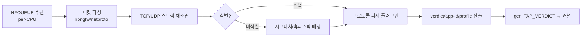

# 06. DPI 프레임워크 (APP-ID)

## 1. 책임/범위

`ngfw-engine`의 검사 코어: 스트림 재조립, 프로토콜 식별, 파서 플러그인, APP-ID 분류, verdict
생성, 커널/`ngfwd`와의 인터페이스. IPS/URL/TLS 등 응용은 `07`이 본 프레임워크 위에서 동작한다.

## 2. 검사 파이프라인(엔진 내부)



## 3. 스트림 재조립

- 자체 TCP 재조립기: 시퀀스 범위 관리(리스트 기반 갭), 순서 도착 대기 한도(플로우당 기본 1MiB,
  초과 시 `reassembly-limit` 이벤트 + 해당 플로우 검사 중단→pending-action).
- 방향별 독립 스트림, 요청/응답 묶음(flip) 처리.
- 세션 라이프사이클과 동기: 커널 세션 만료/재평가 이벤트 수신 시 재조립기 정리.
- 프래그먼트: 커널은 재조립하지 않으므로(`04` §5) 엔진은 도착한 완전 패킷만 재조립 대상.

## 4. 식별(분류) 알고리즘

| 단계 | 방법 | 결과 |
|---|---|---|
| 1 | 포트/프로토 사전 지식(저확신) | 후보 앱 집합 |
| 2 | TLS/SNI·QUIC CID/SNI·HTTP Host·DNS qname 등 메타 필드 추출 | 강 신호 |
| 3 | 페이로드 시그니처(멀티패턴 AC, `07` §2 재사용) | 강 신호 |
| 4 | 프로토콜 상태머신 검증(파서가 옥텟 소비 성공) | 확정 |
| 5 | 학습/캐시: (tuple 패턴→앱) 세션 캐시, 동일 목적지 반복 신속 분류 | 가속 |

- 미확정 유지 정책: 최대 예산(패킷/바이트, `04` §4)까지 확신도 누적, 초과 시 `unknown-app`으로
  확정(정책이 unknown-app 규칙을 둘 수 있음).
- 계층형 APP-ID: `category → app → subtype`(예: `web/media → youtube → video-stream`).
  ID 공간은 `06`과 유일 계약이며 정적 테이블+사용자 정의 앱(시그니처 조합) 지원.

## 5. tap 인터페이스(NFQUEUE)

- 큐-스레드 결합: 큐 i → tap-in 스레드 i(`02` §4.3). mmap 모드 일괄 수신/verdict 송신.
- verdict 메시지: queue id, packet id, verdict(accept/drop/stolen), app_id, 추가 검사 요구 플래그,
  세션 프로필 비트. "stolen"은 패킷을 엔진이 보유(재조립 대기)를 의미 — 커널은 해당 패킷만 보류.
- 세션 verdict와 패킷 verdict를 구분: 패킷 verdict는 즉시, 세션 verdict는 분류 확정 시 genl로
  커널 세션에 기록(`03` §8).

## 6. 파서 플러그인(프레임워크 계약)

플러그인 ABI 세부는 `19-plugin-architecture.md`. 파서 계약 요지:

```c
/* Protocol parser plugin contract (v1). All hooks run in tap-in thread context. */
struct ngfw_parser_ops {
	uint32_t	protocol_id;	/* registered app/protocol id */
	const char	*name;		/* "http", "tls", ... */
	int	(*init)(void **ctx);	/* per-parser global state */
	int	(*flow_init)(void *fctx);	/* per-flow parser state */
	enum ngfw_class_result
		(*consume)(void *fctx, struct ngfw_stream_dir *dir,
			   uint32_t app_id_hint);
	void	(*flow_fini)(void *fctx);
	void	(*fini)(void *ctx);
};
```

- 내장 파서(M1~M3): DNS, HTTP/1.x, TLS(1.2/1.3 메타), QUIC(v1), SMTP, FTP, SSH 배너, SMB(기본),
  RDP(기본), SIP(기본).
- 파서 등록은 빌드 내장 + 동적 플러그인 모두 동일 ABI. 파서는 verdict에 app-id만 확정하고
  콘텐츠 판정은 `07` 서브시스템이 구독하는 구조(느슨한 결합, R07).

## 7. 커널/`ngfwd`와의 상호작용

- 세션 verdict/app 변경: genl 이벤트 수신 + TAP_VERDICT 송신(`03` §7.1).
- 세션 이벤트 스트림은 mmap 공유 링(`02` §6)으로 수신(커널 genl 이벤트를 ngfwd가 수신→엔진으로
  릴레이하는 중계 구조: 커널은 ngfwd 1개 멀티캐스트 구독자만 유지).
- 엔진 크래시: `ngfwd`가 재시작, 커널 pending 세션은 타임아웃 후 pending-action(`04` §7).

## 8. 자원 한계/등록

| 자원 | 한도(기본) | 초과 동작 |
|---|---|---|
| 동시 검사 플로우 | 64K/코어 | 신규 검사 요구 즉시 pending-action |
| 플로우당 재조립 버퍼 | 1MiB | 검사 중단(§3) |
| 이벤트 발행 | 1K/s/종류 | 집계 |

모든 한도는 설정 가능하며 `12-observability.md` 메트릭으로 노출된다.

## 9. selftest 연계

`ngfw selftest dpi`: 재조립(순서역전/중복/갭) 골드 케이스, 각 내장 파서 샘플 트레이스 분류,
APP-ID 재평가, tap verdict 라운드트립, 한도 동작. `17` §4.

## Change log

- 2026-10-23: 초판 작성.
