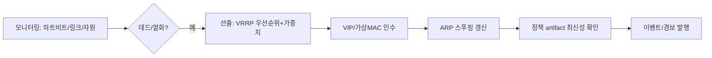

# 13. 고가용성 (HA)

libngfw `ha` 서브시스템(`ngfwd` 내 모듈). 두 장치 active/passive(상태 동기)를 기본으로 하고,
active/active는 M5 이후 확장.

## 1. 구성 요소

| 요소 | 설계 |
|---|---|
| VRRPv3 | 자체 구현(RFC 5798), 가상 IP/가상 MAC, preempt 모드 옵션 |
| HA 링크 | 전용 포트(직접 연결 권장) + 폴백(데이터 링크, 지연 증가 허용) |
| 상태 모니터 | 피어 생존(하트비트 1s/데드 3회), 추적 인터페이스 링크/헬스 가중치 |
| 설정 동기화 | 마스터→슬레이브 원자 전파(버전 확인 + 서명), 슬레이브 커밋 금지 |
| 세션 동기화 | 커널 세션 델타 동기(생성/갱신/만료 이벤트 배치, 압축), sync_id 기반 |
| 전환 | 무중단 전환 목표: 세션 유지(동기화 세션), 미동기 세션은 정책 재판정 |

## 2. 세션 동기화 프로토콜

- 전송: HA 링크 TCP, 자체 TLV 프레임(버전 핸드셰이크, 시퀀스, CRC). 세션 배치 크기 적응.
- 정합성: 주기 전체 스냅샷 재조정(기본 5분) + 이벤트 델타. 갭 감지 시 재동기화 요청.
- 커널 연계: `ngfwd`가 이벤트를 커널 세션에 반영(SESSION 관련 genl 확장 cmd, `03` §7.1에
  SESSION_SYNC 추가로 확정 기록).

## 3. 페일오버 의사결정

- split-brain 방지: HA 링크 + 추적 링크 이중 판정, 양쪽 활성 감지 시 낮은 우선순위측 자기 강등.
- 전환 시간 목표: 측정 기준은 `14` §2(R-P-G). 설정 완전 동기 전제 하에 세션 손실 최소화.

## 4. 설정/펌웨어 정합성

- 버전 불일치 피어: 동기화 거부 + 경보(업그레이드 절차는 개별 수행 후 재조인).
- 슬레이브는 정책 artifact만 수신 적용, 로컬 설정 편집 차단(전환 후 자동 해제).

## 5. selftest 연계

`ngfw selftest ha`: QEMU 2-노드 토폴로지 — 선출/전환/복귀, 세션 동기화 왕복, split-brain 시나리오,
설정 동기화. `17` §5.

## Change log

- 2026-10-23: 초판 작성.
